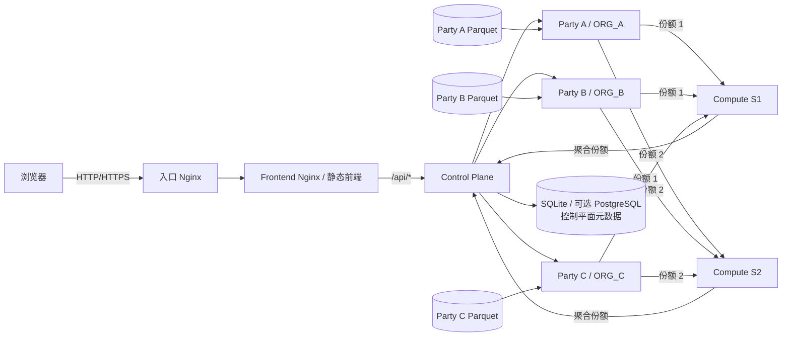

# PrivGrid 部署与操作手册

## 1. 项目概述

PrivGrid 是面向能源可信数据空间的多方安全协同与隐私保护平台。当前实现由一个控制平面、三个数据方节点、两个非串通计算节点和一个前端网关组成，支持：

- 数据使用申请、园区独立审批与 Grant 授权；
- `SUM`、`COUNT`、`AVERAGE`、`TIME_SERIES` 四类受控统计；
- `PLAIN`、`SECRET_SHARE`、`DISTRIBUTED_DP` 三种计算模式；
- Grant 范围校验、隐私预算预留/扣减/释放和安全审计；
- 自然语言 Agent 生成结构化查询草案；
- 园区 CSV 完整快照导入、校验、激活和回滚；
- 基于独立合成数据的性能 Benchmark；
- ANALYST、DATA_OWNER、AUDITOR、ADMIN 四类角色界面。

平台不向普通分析员提供原始 Parquet/CSV 下载。业务数据保留在 Party 节点；Compute 节点只接收秘密份额，Control Plane 负责认证、授权、任务编排、结果重构和审计元数据。

## 2. 系统架构

### 2.1 组件关系



### 2.2 七个应用服务

| 服务 | 默认容器名 | 职责 | 是否持有原始业务数据 |
|---|---|---|---|
| Frontend | `privgrid-frontend` | 静态页面、SPA 路由、`/api/` 反向代理 | 否 |
| Control Plane | `privgrid-control` | 会话、RBAC、申请审批、Grant、任务、预算、审计、Agent | 否，仅持有控制元数据 |
| Party A | `privgrid-party-a` | ORG_A 本地查询、裁剪、份额生成、导入版本 | 是，仅 ORG_A |
| Party B | `privgrid-party-b` | ORG_B 本地查询、裁剪、份额生成、导入版本 | 是，仅 ORG_B |
| Party C | `privgrid-party-c` | ORG_C 本地查询、裁剪、份额生成、导入版本 | 是，仅 ORG_C |
| Compute S1 | `privgrid-compute-s1` | 接收并聚合第一份秘密份额 | 否 |
| Compute S2 | `privgrid-compute-s2` | 接收并聚合第二份秘密份额 | 否 |

### 2.3 业务查询链路

```text
分析员选择 Grant 或输入自然语言
  → Agent 生成结构化草案（不自动提交）
  → 用户确认参数
  → Control Plane 校验会话、角色、Grant 范围和预算
  → Party 在本地固定数据版本并完成受控统计
  → Party 生成两份秘密份额并分别发送至 S1/S2
  → S1/S2 独立聚合
  → Control Plane 合并聚合份额并重构结果
  → 成功时扣减 DP 预算，失败时释放预留
  → 前端展示结果、执行状态与审计信息
```

## 3. 环境要求

### 3.1 软件要求

| 项目 | 要求 |
|---|---|
| 操作系统 | 本地可使用 Windows 10/11 + Docker Desktop；服务器建议使用主流 64 位 Linux |
| 容器运行时 | Docker Engine 或 Docker Desktop |
| Compose | Docker Compose v2，即 `docker compose` 子命令 |
| 浏览器 | 最新稳定版 Chrome 或 Edge；语音输入要求 HTTPS 或 `localhost` |
| 源码构建 | Docker 构建即可；直接运行前端时需要 Node.js，后端需要 Python 3.11 兼容环境 |
| 网络 | 六节点部署要求节点间私网互通，时间同步正常 |

功能验收环境应为容器、镜像和三方数据预留足够 CPU、内存及磁盘空间。硬件数值不是代码中的强制阈值，应依据数据规模、并发量和 Benchmark 轮次单独评估。

### 3.2 端口规划

| 服务 | 容器端口 | 单机默认宿主机端口 | 六节点建议暴露范围 |
|---|---:|---:|---|
| Frontend Nginx | 80 | 8080 | 仅 Control ECS 回环地址 8080，由入口 Nginx 提供 80/443 |
| Control Plane | 8000 | 8000 | 仅容器网络或 Control ECS 本机，不向公网开放 |
| Party A | 8101 | 8101 | 私网，仅允许 Control 与必要运维来源 |
| Party B | 8102 | 8102 | 私网，仅允许 Control 与必要运维来源 |
| Party C | 8103 | 8103 | 私网，仅允许 Control 与必要运维来源 |
| Compute S1 | 8201 | 8201 | 私网，仅允许 Control、Party A/B/C |
| Compute S2 | 8202 | 8202 | 私网，仅允许 Control、Party A/B/C |
| PostgreSQL（可选） | 5432 | 不应公开 | 仅 Compose 内部网络 |

## 4. 比赛交付包结构

```text
PrivGrid-技术实现材料/
├─ 01-完整源代码/
│  ├─ PrivGrid-Source/
│  └─ PrivGrid-Source.zip
├─ 02-部署镜像/
│  ├─ privgrid-backend-v4.tar
│  └─ privgrid-frontend-v5.tar
├─ 03-部署配置/
│  ├─ docker-compose.yml
│  └─ cloud/                  # Control、Party A/B/C、Compute S1/S2
├─ 04-技术文档/
│  └─ PrivGrid部署与操作手册.pdf
└─ 05-补充材料/
```

源码副本包含 backend、frontend、deploy、docs、scripts 和确定性合成 Benchmark 数据。真实环境文件、私钥、账号凭据及镜像仓库凭据不进入提交包。
## 5. Docker 离线镜像

### 5.1 随提交材料提供的镜像

技术实现材料已经包含：

```text
02-部署镜像/
├─ privgrid-backend-v4.tar
└─ privgrid-frontend-v5.tar
```

| 离线镜像标签 | 用途 |
|---|---|
| `privgrid-backend:v4` | Control Plane、Party A/B/C、Compute S1/S2 |
| `privgrid-frontend:v5` | Frontend |

上述镜像已经过最终功能验证。比赛交付不需要重新构建镜像，也不需要访问任何在线镜像仓库。

### 5.2 导入离线镜像

```bash
docker load -i privgrid-backend-v4.tar
docker load -i privgrid-frontend-v5.tar
docker image ls
```

### 5.3 验证镜像

`docker image ls` 应直接出现：

```text
privgrid-backend    v4
privgrid-frontend   v5
```

TAR 内标签已与比赛版 Compose 对齐，不需要再次执行 `docker tag`。

### 5.4 使用 Compose 启动

准备环境变量与数据后，进入比赛版部署配置目录执行：

```bash
docker compose config -q
docker compose up -d
docker compose ps
```

比赛版 Compose 设置 `pull_policy: never`，只使用本机已加载镜像；整个标准流程不需要互联网连接。
## 6. 环境变量配置

真实值只应写入部署机器上的 `.env` 或根目录 `.env.docker`。检查 Compose 时使用 `docker compose config -q`，避免打印展开后的敏感变量。

<style media="print">table{width:100%;max-width:100%;page-break-inside:auto;break-inside:auto}thead{display:table-header-group!important}tbody{display:table-row-group!important}tr{page-break-inside:avoid!important;break-inside:avoid-page!important}td,th{overflow-wrap:anywhere;word-break:break-word}td code,th code{white-space:normal!important;overflow-wrap:anywhere!important;word-break:break-all!important}</style>

### 6.1 控制平面与通用变量

| 变量 | 用途 | 示例占位符/说明 |
|---|---|---|
| `APP_ENV` | 后端运行环境 | `development`、`testing` 或 `production` |
| `DATABASE_URL` | 控制平面数据库连接 | `<SQLite 或 PostgreSQL URL>` |
| `SERVICE_NAME` | 服务标识 | 通常由 Compose 固定 |
| `PORT` | 服务监听端口 | 通常由 Compose 固定 |
| `REQUEST_TIMEOUT` | 服务间请求超时秒数 | `<正数>` |
| `CALCULATION_MODE` | 业务任务计算模式 | `PLAIN`、`SECRET_SHARE`、`DISTRIBUTED_DP` |

<div style="page-break-before:always;break-before:page"></div>

| 变量 | 用途 | 示例占位符/说明 |
|---|---|---|
| `PARTY_A_URL` | Control 到 Party A 的地址 | `http://<PARTY_A_PRIVATE_IP>:<PORT>` |
| `PARTY_B_URL` | Control 到 Party B 的地址 | `http://<PARTY_B_PRIVATE_IP>:<PORT>` |
| `PARTY_C_URL` | Control 到 Party C 的地址 | `http://<PARTY_C_PRIVATE_IP>:<PORT>` |
| `COMPUTE_S1_URL` | Control/Party 到 Compute S1 的地址 | `http://<COMPUTE_S1_PRIVATE_IP>:<PORT>` |
| `COMPUTE_S2_URL` | Control/Party 到 Compute S2 的地址 | `http://<COMPUTE_S2_PRIVATE_IP>:<PORT>` |
| `FRONTEND_GATEWAY_URL` | Control 健康检查前端地址 | 容器内通常为 `http://frontend` |
| `CORS_ORIGINS` | 允许的浏览器来源 | `<HTTPS 入口地址>`，多个值用逗号分隔 |
| `INTERNAL_SERVICE_TOKEN` | 内部接口鉴权令牌 | `<高强度随机值>`；六节点必须一致 |
| `AGGREGATE_POLL_INTERVAL` | 聚合状态轮询间隔 | `<正数秒>` |
| `AGGREGATE_POLL_ATTEMPTS` | 聚合状态最大轮询次数 | `<正整数>` |
| `PRIVACY_SUBJECT_ID` | 未启用 Grant 账本时的预算主体 | 仅兼容/测试路径使用 |

### 6.2 认证、授权与预算变量

| 变量 | 用途 | 安全要求 |
|---|---|---|
| `AUTHORIZATION_ENFORCEMENT_ENABLED` | 启用 Grant 强制校验 | 正式验收应为 `true` |
| `DEFAULT_TOTAL_EPSILON` | 未启用 Grant 账本时的默认预算 | 仅按实验方案设置，不在前端硬编码 |
| `SESSION_TTL_SECONDS` | 会话有效期 | 按安全要求设置 |
| `SESSION_COOKIE_NAME` | 会话 Cookie 名 | 可保留项目默认名 |
| `SESSION_COOKIE_SECURE` | 仅通过 HTTPS 发送 Cookie | HTTPS 部署应为 `true` |
| `DEMO_SEED_ENABLED` | 是否初始化预置演示账号 | 仅在受控演示环境启用 |
| `DEMO_ANALYST_PASSWORD` 等 | 各预置角色初始密码 | `<分别设置的强密码>`，禁止提交 |

### 6.3 Agent 变量

| 变量 | 用途 | 安全要求 |
|---|---|---|
| `DEEPSEEK_API_KEY` | 后端调用兼容模型接口 | `<模型服务密钥>`；只放后端环境变量 |
| `DEEPSEEK_BASE_URL` | 模型接口根地址 | `<兼容接口地址>` |
| `DEEPSEEK_MODEL` | 模型名称 | `<已获授权的模型名>` |
| `DEEPSEEK_TIMEOUT_SECONDS` | 模型请求超时 | `<正数>` |
| `DEEPSEEK_MAX_TOKENS` | 最大输出令牌数 | 可选 |
| `DEEPSEEK_TEMPERATURE` | 生成温度 | 当前安全解析建议使用低温度 |
| `AGENT_RATE_LIMIT_PER_MINUTE` | 单客户端 Agent 限流 | `<正整数>` |

### 6.4 Party、导入与隐私参数

| 变量 | 用途 |
|---|---|
| `PARTY_ID` | 当前 Party 对应的 `ORG_A`、`ORG_B` 或 `ORG_C` |
| `PARQUET_PATH` | 只读基线 Parquet 容器路径 |
| `BENCHMARK_DATA_PATH` | 合成 Benchmark Parquet 容器路径 |
| `IMPORT_STORAGE_DIR` | 导入版本持久化目录 |
| `CSV_IMPORT_ENABLED` | 是否启用 CSV 导入 |
| `CSV_IMPORT_MAX_BYTES` | CSV 大小上限，当前 Compose 为 50 MiB |
| `CSV_IMPORT_MAX_ROWS` | CSV 行数上限，当前 Compose 为 500,000 |
| `CSV_IMPORT_ALLOWED_ENCODINGS` | 允许编码，当前为 UTF-8/UTF-8-SIG |
| `RECORD_CAP` | 单记录贡献裁剪上限 |
| `MAX_RECORDS_PER_HOUSEHOLD_PER_DAY` | 每户每日最大贡献记录数 |
| `MAX_WINDOW_CAP` | 时间窗口总贡献上限 |
| `EPSILON_SUM_RATIO` | AVERAGE 的求和预算比例 |
| `EPSILON_COUNT_RATIO` | AVERAGE 的计数预算比例 |
| `MINIMUM_DENOMINATOR` | 受保护均值计算的最小分母 |
| `COMPUTE_NODE_ID` | Compute 节点标识 `S1` 或 `S2` |

### 6.5 数据库与前端构建变量

| 变量 | 用途 | 说明 |
|---|---|---|
| `POSTGRES_PASSWORD` | `compose.prod.yaml` 的 PostgreSQL 密码 | `<高强度随机值>`，仅可选 PostgreSQL 部署使用 |
| `VITE_API_BASE_URL` | 前端构建时 API 前缀 | Dockerfile 默认 `/api` |
| `VITE_USE_MOCK` | 是否使用前端 Mock | 正式镜像固定为 `false` |

## 7. 数据准备与挂载

### 7.1 基线数据

三个 Party 使用相同 schema，但各自只挂载自己的文件：

| Party | 宿主机文件 | 容器内只读路径 |
|---|---|---|
| ORG_A | `data_processed/party_a.parquet` | `/app/data/party_a.parquet` |
| ORG_B | `data_processed/party_b.parquet` | `/app/data/party_b.parquet` |
| ORG_C | `data_processed/party_c.parquet` | `/app/data/party_c.parquet` |

数据字段为：

| 字段 | 类型 | 约束 |
|---|---|---|
| `household_id` | string | 非空，最多 128 字符，CSV 导入时不得以公式触发字符开头 |
| `organization_id` | string | 必须与当前 Party 一致 |
| `timestamp` | timestamp[us] | 无时区 ISO-8601 时间 |
| `energy_kwh` | double | 有限、非负 |

唯一键为 `household_id + timestamp`。CSV 不得缺列、重复列或增加列；上传不会自动激活。

### 7.2 Benchmark 数据

`benchmark-data/` 中的三个 Parquet 是确定性生成的合成能源负荷数据，默认每个 Party 100,000 行，标识符使用 `SYNTHETIC_*` 前缀，不参与业务 Grant 和业务预算。

重新生成：

```powershell
backend\.venv\Scripts\python.exe scripts\generate_benchmark_data.py --rows 100000
```

脚本只读取基线 Parquet 的 schema，不读取、抽样或派生真实数据行。

### 7.3 持久化与挂载矩阵

| 内容 | 单机 Compose | 六节点模板 | 保留策略 |
|---|---|---|---|
| Control SQLite | `privgrid-control-data:/app/data` | 同名 Docker 卷 | 必须备份；禁止随意删除卷 |
| Party A 导入版本 | `privgrid-party-a-imports:/app/imported` | `/opt/privgrid/imported:/app/imported` | 仅留在 Party A |
| Party B 导入版本 | `privgrid-party-b-imports:/app/imported` | `/opt/privgrid/imported:/app/imported` | 仅留在 Party B |
| Party C 导入版本 | `privgrid-party-c-imports:/app/imported` | `/opt/privgrid/imported:/app/imported` | 仅留在 Party C |
| 三方基线 Parquet | `./data_processed/...:/app/data/...:ro` | 各 Party 的 `/opt/privgrid/data/...:ro` | 只读挂载、按园区隔离 |
| 三方 Benchmark Parquet | `./benchmark-data/...:/app/benchmark/...:ro` | 各 Party 的 `/opt/privgrid/benchmark/...:ro` | 只读、仅合成数据 |
| 可选 PostgreSQL | `privgrid-postgres-data` | 当前六节点模板未使用 | 按数据库流程备份 |

### 7.4 校验文件

```powershell
Get-FileHash data_processed\party_a.parquet -Algorithm SHA256
Get-FileHash benchmark-data\party_a_benchmark.parquet -Algorithm SHA256
```

Linux：

```bash
sha256sum /opt/privgrid/data/party_a.parquet
sha256sum /opt/privgrid/benchmark/party_a_benchmark.parquet
```

## 8. 单机 Docker Compose 离线部署

### 8.1 准备文件

将以下内容放在同一交付目录结构中：

- `02-部署镜像/privgrid-backend-v4.tar`；
- `02-部署镜像/privgrid-frontend-v5.tar`；
- `03-部署配置/docker-compose.yml`；
- 三方基线 Parquet 与三方合成 Benchmark Parquet；
- 仅在部署机器上创建的 `.env.docker`。

`.env.docker` 用于填写内部服务令牌、会话、可选模型接口等真实配置，不包含任何镜像仓库字段。

### 8.2 加载镜像

```bash
cd 02-部署镜像
docker load -i privgrid-backend-v4.tar
docker load -i privgrid-frontend-v5.tar
docker image ls
```

### 8.3 检查并启动

进入 `03-部署配置`，确认数据相对路径与环境文件就绪：

```bash
docker compose -f docker-compose.yml config -q
docker compose -f docker-compose.yml up -d
docker compose -f docker-compose.yml ps
```

预期七个应用服务最终均为 `healthy`。默认入口为：

```text
http://localhost:8080
```

### 8.4 首轮健康检查

```powershell
Invoke-WebRequest http://localhost:8080/healthz -UseBasicParsing
Invoke-WebRequest http://localhost:8000/health -UseBasicParsing
Invoke-WebRequest http://localhost:8101/health -UseBasicParsing
Invoke-WebRequest http://localhost:8102/health -UseBasicParsing
Invoke-WebRequest http://localhost:8103/health -UseBasicParsing
Invoke-WebRequest http://localhost:8201/health -UseBasicParsing
Invoke-WebRequest http://localhost:8202/health -UseBasicParsing
```

`compose.prod.yaml` 是源码副本中的可选 PostgreSQL 参考拓扑，不属于比赛标准离线启动路径。比赛验收应使用 `03-部署配置/docker-compose.yml`。
## 9. 六节点离线部署

### 9.1 节点规划

| 节点 | 服务 | 工作目录 | 数据 |
|---|---|---|---|
| Control | Control Plane + Frontend + 入口 Nginx | `/opt/privgrid` | 控制平面命名卷，不放 Party 原始数据 |
| Party A | Party A | `/opt/privgrid` | 仅 ORG_A 基线、Benchmark 和导入目录 |
| Party B | Party B | `/opt/privgrid` | 仅 ORG_B 基线、Benchmark 和导入目录 |
| Party C | Party C | `/opt/privgrid` | 仅 ORG_C 基线、Benchmark 和导入目录 |
| Compute S1 | Compute S1 | `/opt/privgrid` | 不放 Parquet |
| Compute S2 | Compute S2 | `/opt/privgrid` | 不放 Parquet |

需保留并填写以下私网通信参数：

```text
CONTROL_PRIVATE_IP
PARTY_A_PRIVATE_IP
PARTY_B_PRIVATE_IP
PARTY_C_PRIVATE_IP
COMPUTE_S1_PRIVATE_IP
COMPUTE_S2_PRIVATE_IP
```

### 9.2 镜像分发

把 `privgrid-backend-v4.tar` 复制到 Control、Party A/B/C、Compute S1/S2 六台节点。把 `privgrid-frontend-v5.tar` 额外复制到 Control。节点不需要访问外部镜像仓库。

Compute、Party 与 Control 均执行：

```bash
docker load -i privgrid-backend-v4.tar
```

Control 额外执行：

```bash
docker load -i privgrid-frontend-v5.tar
```

### 9.3 部署文件与数据

每台节点只上传 `03-部署配置/cloud/` 下对应目录中的 `compose.yaml`，并在本机创建 `.env`。Party 数据按归属分别放置；严禁把三方业务数据集中到同一 Party。Compute 不放 Parquet，Control 不放 Party 原始业务数据。

比赛公开副本只保留地址占位符，不包含真实私网地址、密码、内部令牌、模型密钥或证书私钥。

### 9.4 安全组原则

- 公网仅开放 Control 入口的 80/443 和受控 SSH；
- Party 8101/8102/8103 仅走私网；
- Compute 8201/8202 仅走私网；
- Control Plane 8000 不向公网发布；
- 所有 ECS 使用一致的强随机 `INTERNAL_SERVICE_TOKEN`。

### 9.5 启动顺序

跨主机 Compose 无法管理其他节点，必须依次启动：

1. Compute S1、Compute S2；
2. Party A、Party B、Party C；
3. Control Plane、Frontend；
4. 入口 Nginx/HTTPS。

每台节点执行：

```bash
cd /opt/privgrid
docker compose config -q
docker compose up -d
docker compose ps
```

### 9.6 HTTPS 入口

比赛材料提供 `cloud/control/nginx/` 入口配置模板。部署前需把 `server_name`、证书路径和跳转目标改为实际公网域名或 IP，但不得把私钥写入公开材料。Frontend 容器只绑定 `127.0.0.1:8080`，由宿主机 Nginx 代理。

语音输入依赖浏览器安全上下文，因此公网演示应使用有效 HTTPS；纯 HTTP 公网地址只能使用文字输入。
## 10. 启动、停止、更新与日志

### 10.1 日常启动

```bash
docker compose up -d
docker compose ps
```

### 10.2 安全停止

仅停止容器：

```bash
docker compose stop
```

删除容器和网络但保留命名卷：

```bash
docker compose down
```

禁止在有验收数据时执行：

```text
docker compose down -v
```

`-v` 会删除 Control SQLite/PostgreSQL 卷和 Party 导入卷，可能导致申请、Grant、预算、任务、审计和导入版本丢失。

### 10.3 查看日志

```bash
docker compose logs --tail=100
docker compose logs --tail=200 control-plane
docker compose logs -f party-a
```

日志、截图和问题单中不得粘贴 Cookie、Authorization、API Key、内部服务令牌或完整环境文件。

### 10.4 离线更新镜像

取得新版离线 TAR 后，在对应节点重新加载，再更新容器：

```bash
docker load -i privgrid-backend-v4.tar
# Control 节点按需额外加载 frontend TAR
docker load -i privgrid-frontend-v5.tar
docker compose config -q
docker compose up -d
docker compose ps
```

加载前后可使用 `docker image inspect privgrid-backend:v4` 和 `docker image inspect privgrid-frontend:v5` 记录镜像 ID。比赛部署不使用在线仓库更新路径。
## 11. 健康检查与连通性验证

### 11.1 容器内部健康端点

| 服务 | 端点 |
|---|---|
| Frontend | `/healthz` |
| Control Plane | `/health` |
| Party A/B/C | `/health` |
| Compute S1/S2 | `/health` |

### 11.2 容器状态

```bash
docker compose ps
docker inspect --format '{{.Name}} {{.State.Status}} {{if .State.Health}}{{.State.Health.Status}}{{end}}' $(docker compose ps -q)
```

### 11.3 六节点私网检查

在 Control ECS 上使用占位符验证：

```bash
curl --fail http://<PARTY_A_PRIVATE_IP>:8101/health
curl --fail http://<PARTY_B_PRIVATE_IP>:8102/health
curl --fail http://<PARTY_C_PRIVATE_IP>:8103/health
curl --fail http://<COMPUTE_S1_PRIVATE_IP>:8201/health
curl --fail http://<COMPUTE_S2_PRIVATE_IP>:8202/health
curl --fail http://127.0.0.1:8080/healthz
```

登录后，前端“系统总览”通过 `/api/v1/system/health` 展示真实节点状态、延迟和版本；普通业务页面不显示内部服务 URL。

## 12. 登录与角色操作

部署负责人应通过环境变量为预置账号设置独立强密码，或由 ADMIN 在“账号与权限”页面创建/维护账号。本文不提供默认密码。

### 12.1 ANALYST（数据分析员）

菜单：系统总览、数据目录、我的申请、新建申请、我的授权、授权查询、任务与计算、报表中心、性能测试。

标准流程：

1. 在“数据目录”查看可申请资产；
2. 在“新建申请”填写用途、园区、查询类型、时间范围、时间粒度和预算上限；
3. 在“我的申请”查看各园区审批进度；
4. 审批完成后，在“我的授权”查看 Grant 范围和剩余 ε；
5. 点击“使用此授权查询”进入智能隐私查询；
6. 通过自然语言或参数编辑生成任务，确认后提交；
7. 在“任务与计算”查看执行拓扑、状态和结果；
8. 在“报表中心”查看本人真实任务和预算汇总。

### 12.2 DATA_OWNER（园区管理员）

菜单：系统总览、待我审批、审批历史、本园区授权、数据接入、安全策略中心。

标准流程：

1. 在“待我审批”打开申请详情；
2. 核对申请园区、允许查询类型、时间范围、单次 ε、累计 ε 和到期时间；
3. 可在不扩大申请范围的前提下收紧审批范围；
4. 提交批准或拒绝决定；
5. 在“审批历史”和“本园区授权”复核结果；
6. 在“数据接入”上传完整 CSV 快照，等待校验后手工激活或回滚；
7. 在“安全策略中心”查看当前策略与 Party/Compute 健康状态。

DATA_OWNER 只能处理绑定园区的数据和审批，不能跨园区操作。

### 12.3 AUDITOR（审计员）

菜单：系统总览、申请审计、审批审计、授权审计、查询和预算审计。

审计员只读查看申请范围、多方审批轨迹、Grant 状态、任务、预算和安全事件。审计数据来自控制平面记录，不代表区块链存证；当前实现未引入区块链。

### 12.4 ADMIN（系统管理员）

菜单：系统总览、全部申请、全部授权、账号与权限、安全审计、系统设置。

管理员可查看全局状态，创建/编辑账号、重置密码、启停账号、撤销会话，以及查看安全事件和运行依赖。管理员页面不提供任意修改 Party 原始数据或隐私计算结果的能力。

## 13. Agent 智能隐私查询

### 13.1 使用流程

1. ANALYST 进入“授权查询”；
2. 选择有效 Grant；
3. 在 Agent 工作台输入问题，例如“查询 B、C 园区指定日期的总用电量”；
4. 后端模型服务把自然语言解析为查询类型、参与方、时间范围、时间粒度和 ε 草案；
5. 前端以流式打字效果展示回答，并同步到“当前任务”；
6. 用户检查草案，必要时点击“编辑参数”；
7. 用户主动点击“提交隐私查询”；
8. Control Plane 再次执行完整授权和预算校验。

Agent 只负责理解、解释和填写草案，不能绕过 RBAC、Grant 范围、时间范围或预算约束，也不会在解析后自动提交任务。

### 13.2 会话与安全边界

- 历史会话按当前登录用户保存；
- 模型密钥只存在于后端环境变量；
- 日志记录请求摘要、哈希、意图、延迟和结果状态，不记录 API Key 或完整模型响应；
- Party 原始 Parquet 行不会交给 Agent；
- 模型未配置、超时或返回非法结构时，页面给出可读提示，用户仍可使用参数编辑；
- 所有模型生成字段都由后端 schema 和授权服务复核。

### 13.3 中文语音输入

语音输入使用浏览器 Web Speech API：

- 推荐 Chrome 或 Edge；
- 语言设置为 `zh-CN`；
- 必须运行在 HTTPS 或 `localhost`；
- 首次使用需允许麦克风权限；
- 识别内容只写入输入框，不自动发送、不自动提交查询；
- 不支持或识别失败时可继续使用文字输入。

## 14. 任务执行状态

前端按后端真实状态映射为六步：

1. 权限与预算校验；
2. 园区本地统计；
3. 秘密份额生成；
4. 安全聚合；
5. 结果重构；
6. 完成。

任务状态和监控接口来自 Control Plane。失败时应查看任务错误、Control 日志、对应 Party 日志和 S1/S2 日志；不要仅依据前端动画判断后端完成状态。

## 15. 三种计算模式

| 模式 | 当前实现 | Compute 参与 | DP ε 消耗 | 适用目的 |
|---|---|---:|---:|---|
| `PLAIN` | Party 返回本地统计，Control 汇总 | 否 | 否 | 基准对照与功能校验 |
| `SECRET_SHARE` | Party 将本地统计编码为两份秘密份额，S1/S2 分别聚合，Control 重构 | 是 | 否 | 验证秘密共享通信和聚合开销 |
| `DISTRIBUTED_DP` | 在秘密共享流程中加入分布式差分隐私参数和噪声保护 | 是 | 是 | 正式隐私保护查询 |

业务任务默认模式由后端 `CALCULATION_MODE` 决定。性能测试页面可针对合成基准数据独立选择三种模式，用于可比实验；这不改变业务任务配置。

## 16. Grant 与隐私预算

### 16.1 Grant 校验范围

每次任务都校验：

- Grant 是否存在、属于当前 ANALYST 且状态可用；
- 参与园区是否为 Grant 允许园区的子集；
- 查询类型是否被允许；
- 开始/结束时间是否落在授权窗口内；
- `TIME_SERIES` 的 `group_by` 是否允许；
- 单次 ε 是否不超过 `max_epsilon_per_query`；
- Grant 是否未过期、未撤销；
- DP 模式下累计剩余 ε 是否充足。

### 16.2 预算公式

```text
剩余 ε = 累计 ε 上限 - 已消耗 ε - 已预留 ε
```

不同 Grant 的预算相互独立。报表中的用户总剩余预算可以是多个有效 Grant 剩余值之和，但一次任务只绑定并扣减一个 Grant。

### 16.3 预留、成功扣减和失败释放

1. `DISTRIBUTED_DP` 任务通过授权检查时先增加 `epsilon_reserved`；
2. 任务成功完成后，预留转为 `epsilon_consumed`；
3. 任务失败、超时或执行异常时，释放预留，不增加已消耗值；
4. 相同任务的重复消费/释放处理具有幂等保护，避免重复扣减；
5. 余额归零时 Grant 标记为 `EXHAUSTED`；若仅因全额预留暂时耗尽而任务失败，释放后可恢复 `ACTIVE`；
6. `PLAIN` 和 `SECRET_SHARE` 仍执行 Grant 范围校验，但不预留或消耗 DP ε。

不要在正式验收中调用预算重置脚本。`backend/scripts/reset_demo_budget.py` 仅用于受控开发测试。

## 17. 性能 Benchmark

### 17.1 数据与业务隔离

性能测试只读取 `benchmark-data/party_*_benchmark.parquet`，不访问业务查询结果，不占用业务 Grant，也不扣减业务隐私预算。测试预算只用于 `DISTRIBUTED_DP` 基准参数。

### 17.2 页面指标

| 指标 | 含义 |
|---|---|
| 阶段总耗时 | 页面所列阶段耗时之和；已排除本地数据读取统计展示项 |
| 通信总量 | 跨节点请求与响应字节合计，前端以 KB 并保留两位小数展示 |
| 参与节点 | 本次涉及节点数/六个核心后端节点 |
| 平均响应 | 通信事件的平均节点响应时延 |
| 阶段耗时拆解 | 参数校验、份额生成/传输、安全聚合、结果汇总或重构等真实阶段 |
| 通信开销分布 | 节点之间的实际请求/响应字节 |

### 17.3 批量实验

默认矩阵为 4 种查询类型 × 3 种计算模式，共 12 组；每组默认预热 3 次、正式运行 20 次：

```powershell
python scripts/run_performance_benchmark.py `
  --base-url https://<CONTROL_PUBLIC_HOST> `
  --username <ANALYST_ACCOUNT> `
  --warmup 3 `
  --runs 20
```

密码通过 `getpass` 隐藏输入。输出包括：

- `raw_results_*.csv`：每次正式运行；
- `summary_*.csv`：均值、总体标准差、最小值、最大值；
- 可选的耗时和通信量对比 PNG。

正式报告应同时保留运行参数、镜像摘要、节点规格、网络条件、成功样本数和失败记录，避免只展示最优结果。

## 18. 数据导入操作

1. DATA_OWNER 进入“数据接入”；
2. 选择与当前园区一致的 UTF-8/UTF-8-SIG CSV；
3. 上传后由 Party 完成 schema、组织、非负数值、唯一键和文件上限校验；
4. 合法版本状态变为 `VALID`，不会自动启用；
5. 手工激活后成为 `ACTIVE`，旧版本归档；
6. 必要时回滚到历史有效版本或 `BASELINE`；
7. 任务结果中的 `dataset_versions` 记录实际使用版本，不返回内部文件路径。

原始临时 CSV 在成功或失败后删除；Control 数据库只保存导入元数据和安全审计，不保存逐户记录。

## 19. 常见问题

### 19.1 页面打不开

```bash
docker compose ps
docker compose logs --tail=200 frontend
curl --fail http://127.0.0.1:8080/healthz
```

检查入口 Nginx、前端回环端口和安全组，不要直接把 Frontend 容器管理端口暴露到公网。

### 19.2 API 返回 502 或节点离线

```bash
docker compose logs --tail=200 control-plane
docker compose logs --tail=200 party-a
docker compose logs --tail=200 compute-s1
```

检查私网路由、安全组、服务端口、`PARTY_*_URL`、`COMPUTE_*_URL` 和六节点一致的内部服务令牌。

### 19.3 Agent 不可用

检查后端是否配置模型密钥、接口地址、模型名和超时；不要在浏览器或前端静态文件中查找密钥。模型不可用不应影响手工参数编辑和既有授权查询流程。

### 19.4 语音按钮不可用

确认使用最新版 Chrome/Edge、页面为 HTTPS 或 `localhost`，并允许麦克风权限。公网 HTTP 不属于安全上下文。

### 19.5 预算显示不一致

优先核对当前任务绑定的 `grant_id`，区分已消耗和已预留；不同 Grant 的余额不能互相覆盖。失败任务应为 `RELEASED`，成功 DP 任务应为 `CONSUMED`。

### 19.6 CSV 被拒绝

检查列名、组织归属、UTF-8 编码、非负有限数值、时间格式、文件大小、行数和 `household_id + timestamp` 重复键。系统不会自动删除重复行。

### 19.7 加载新版前端后页面未更新

在 Control 节点确认已经加载随材料交付的前端镜像并重新创建 Frontend 容器：

```bash
docker load -i privgrid-frontend-v5.tar
docker image inspect privgrid-frontend:v5
docker compose up -d frontend
docker compose ps
```

随后强制刷新浏览器，并核对容器实际镜像 ID 与静态资源哈希。
## 20. 验收检查清单

### 20.1 部署

- [ ] Compose 使用预期镜像标签，镜像摘要已记录；
- [ ] 七个应用服务均为 `healthy`；
- [ ] 六节点按 Compute → Party → Control/Frontend 顺序启动；
- [ ] Party/Compute/Control Plane 端口未向公网暴露；
- [ ] HTTPS、会话 Cookie 和浏览器访问正常；
- [ ] `.env`、私钥和凭据未进入提交包或日志。

### 20.2 数据隔离

- [ ] 每个 Party 只挂载本园区基线和 Benchmark 数据；
- [ ] Compute 节点没有 Parquet；
- [ ] Control 节点没有 Party 原始数据；
- [ ] 公开材料仅包含合成/脱敏样例；
- [ ] CSV 导入不会自动激活。

### 20.3 角色与业务

- [ ] ANALYST 可以申请、查看 Grant、提交受控查询；
- [ ] DATA_OWNER 只能审批和管理本园区；
- [ ] AUDITOR 为只读审计；
- [ ] ADMIN 的账号、会话和安全审计操作正常；
- [ ] 非授权角色访问受保护接口时被拒绝。

### 20.4 隐私计算与预算

- [ ] `SUM`、`COUNT`、`AVERAGE`、`TIME_SERIES` 均可按授权运行；
- [ ] `TIME_SERIES` 只使用允许的时间粒度；
- [ ] PLAIN/SECRET_SHARE 不扣减 DP ε；
- [ ] DISTRIBUTED_DP 成功时只扣减一次；
- [ ] 失败任务释放预留；
- [ ] 审计记录可关联申请、审批、Grant 和任务。

### 20.5 Agent 与 Benchmark

- [ ] Agent 只生成草案，不自动提交；
- [ ] 用户可手工编辑并确认参数；
- [ ] 历史会话按用户隔离；
- [ ] HTTPS 下中文语音仅写入输入框；
- [ ] Benchmark 使用合成数据且不影响业务预算；
- [ ] CSV/PNG 结果包含运行参数和成功样本数。

## 21. 测试与构建

### 21.1 前端

```powershell
cd <PROJECT_ROOT>\frontend
npm test
npm run build
node --check src\main.js
node --check src\agent\speech-recognition.js
```

### 21.2 后端

```powershell
cd <PROJECT_ROOT>
$env:PYTHONPATH="backend"
python -m pytest -c backend\pytest.ini
```

### 21.3 Compose

```powershell
docker compose config -q
docker compose -f compose.prod.yaml config -q
```

## 22. 备份、恢复与数据保留

Control Plane 的申请、审批、Grant、预算、任务和审计保存在数据库中；本地/当前六节点 SQLite 位于 `privgrid-control-data` 命名卷。Party 导入版本保存在各自导入卷或 `/opt/privgrid/imported`。

备份前先确认业务静止，并按数据库类型使用一致性备份方式。SQLite 示例：

```bash
docker compose exec control-plane python -c "import sqlite3; source=sqlite3.connect('/app/data/control_plane.db'); target=sqlite3.connect('/app/data/control_plane.backup.db'); source.backup(target); target.close(); source.close()"
docker cp privgrid-control:/app/data/control_plane.backup.db ./control_plane.backup.db
```

备份文件含用户、任务和审计元数据，应按敏感材料管理，不进入公开提交包。

## 23. 卸载

### 23.1 保留数据的卸载

```bash
docker compose down
```

保留命名卷、Party 数据目录、环境文件和离线镜像归档，以便恢复。

### 23.2 完全删除前的确认

完全删除会不可逆清除控制数据库、导入版本和审计记录。必须先完成书面确认、备份和恢复演练。不要在比赛验收或尚未导出证据时执行 `docker compose down -v`、删除 `/opt/privgrid` 或清理全部 Docker 卷。

## 24. 安全与能力边界声明

- 当前审计为控制平面数据库中的安全审计，不宣称区块链存证；
- 当前数据接入为 CSV 完整快照，不包含 MQTT、数据库直连或对象存储直传；
- 当前控制数据库可使用 SQLite，`compose.prod.yaml` 提供可选 PostgreSQL；
- 当前 Agent 依赖后端配置的兼容模型接口，模型不直接访问 Party 原始数据；
- 当前性能页不伪造 CPU、内存、告警或增长率，缺少真实接口时显示 `—`；
- 当前安全目标是受控统计、授权约束、秘密共享、分布式差分隐私和可追溯元数据，不应扩展描述为代码中未实现的能力。
